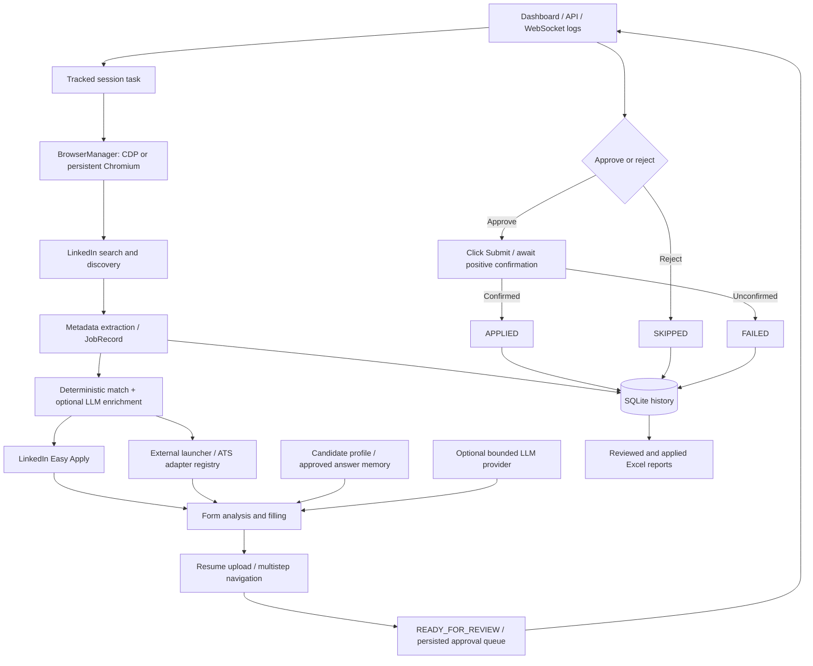

# Current architecture

The application is a local, single-process FastAPI server with a static HTML/CSS/JS
dashboard. One asynchronous Playwright worker processes jobs serially. SQLite is
the durable source for history and exports; browser pages and approval futures
exist only for the current server session.

| Module | Responsibility |
| --- | --- |
| `run.py`, `src/main.py`, `web/` | Launcher, server lifetime, UI, APIs, logs, session and review decisions |
| `src/browser.py`, `src/external_navigation.py` | Browser ownership, session pages, redirects/popups and cleanup |
| `src/scraper.py`, `src/job_extractor.py`, `src/models.py` | LinkedIn discovery, metadata, normalized job lifecycle and per-job recovery |
| `src/database.py`, `src/paths.py`, `src/urls.py` | SQLite persistence, schema migration, recovery, canonical URL identity and Excel |
| `src/evaluation.py`, `src/scoring.py` | Deterministic eligibility and optional AI match enrichment |
| `src/application.py`, `src/form_filler.py`, `src/resume.py` | Field/state contracts, Easy Apply and shared form handling, resume validation/upload |
| `src/external_application.py`, `src/ats/` | External application loop; Greenhouse, Lever, Ashby, basic Workday and generic HTML adapters |
| `src/config.py`, `src/candidate_profile.py` | Atomic configuration writes, legacy field migration and verified candidate facts |
| `src/answer_resolver.py`, `src/answer_memory.py`, `src/llm/` | Answer priority, approval-aware SQLite memory and optional provider transports |
| `src/review.py`, `src/runtime.py` | In-process approval futures and thread-safe runtime snapshot |

## State semantics

Job history uses uppercase states, including DISCOVERED, REVIEWED, NOT_QUALIFIED,
APPLICATION_FOUND, APPLICATION_STARTED, FORM_ANALYZED, FILLING, NEEDS_USER_INPUT,
READY_FOR_REVIEW, SKIPPED, FAILED, CLOSED, DUPLICATE, ALREADY_APPLIED and APPLIED.
Review-decision rows use a separate lowercase lifecycle: `awaiting_approval` ->
`approved` -> `submitted` / `submission_failed`; or `rejected` / `expired`.

REVIEWED means metadata was inspected. READY_FOR_REVIEW means the form reached
the human gate. Neither creates an applied-history row. APPLIED is recorded by
the orchestrator only after the form runner returns positive submission
confirmation. The two history tables update in one SQLite transaction.
Review decisions cannot jump directly from awaiting approval to submitted.

Startup expires stale review futures and marks interrupted form work FAILED;
merely constructing a database reader does not expire active reviews. Applied
records cannot be demoted by a late failure callback. Resolving a teaching item
makes its job retryable; a new missing question can requeue that same record.

The old unused JSON `MemoryStore` implementation was removed. Existing
`data/learned_memory.json` is retained for conservative migration by
`answer_memory.py`; unapproved legacy answers are not silently reused.

## Dashboard placement and provenance

Both discovery modes include all application methods, ignoring the legacy
`easy_apply_only` preference. Search & Save reads listing metadata and available
application links without clicking application controls or visiting ATS pages.
Matched jobs remain Pending; `application_stage` is `not_started`.
An external URL hidden behind a JavaScript button can remain unknown until a
manual visit or Autopilot opens it; discovery never opens a form to obtain it.

`application_method` (`easy_apply`, `external`, `unavailable`),
`application_stage`, and `automation_failure_reason` live on `processed_jobs`.
The existing `application_url` and `ats_type` remain the stored URL/provider;
the dashboard also exposes `external_apply_url` and `ats_provider` as aliases.
Known ATS hosts are identified from listing links without visiting forms.
These describe application handling independently of `source_mode`. Manual
status edits retain application metadata and rejection history. Autopilot uses
the existing Easy Apply and external adapter flows with final approval, and
preserves failed/unsupported applications in the Failed / Flagged view.

`/api/jobs/dashboard` provides one view per canonical job URL. It enriches
`processed_jobs` with existing search-attempt, approval, flagged-question, and
applied-history records, including older records without processed history.
Tabs and source counts derive from this shared view; moving a card does not
create a separate tab collection. Existing workflow APIs and exports remain.

Source and application-method filters intersect within each current-status tab.
Filter counts use the same canonical snapshot and respect the other filter.
Deletion sends an explicit snapshot of visible job URLs plus the tab and both
filters. The database revalidates eligibility in one transaction, then removes
the canonical job and its auxiliary search/flag/review rows. It never deletes
`applied_jobs`; any applied history or active application protects the whole job.
Deletion is unavailable during discovery/application runs to prevent callbacks
from recreating a removed job. Applied has no deletion controls.

`source_mode` records `autopilot` or `search_save`. `original_bucket` records
the first classified outcome (initial discovery/processing states defer this
classification). Manual status changes preserve both fields and all metadata.
Pending manual decisions override automatic skipped/failed placement in the
dashboard while retaining the worker's existing retry and approval semantics.

Legacy provenance is inferred from saved-search states or application-review
records. Other records with missing provenance stay unknown and appear under
All with a LEGACY badge. Existing explicit sources are never overwritten.
The API exposes normalized `job_status`; both lists and counts derive from
that current status before applying source filters. A successful status write
updates the dashboard's single snapshot immediately, without a second fetch.

Manual rejection requires `rejection_reason` and supports optional
`rejection_feedback` on `processed_jobs`. Both save atomically with status;
returning to Pending/Applied retains these fields as history. The dashboard
opens a compact editor before moving the card and allows later editing.
Startup adds nullable columns to existing databases; legacy rejections remain
intact without an invented reason.

## Scope

LinkedIn is the only discovery source. ATS adapters operate external links found
there; they are not independent job-search engines. Adapter detection and form
handling have local fixture coverage. Production LinkedIn/ATS behavior, custom
widgets, account creation, embedded forms and live LLM services are not certified
by these tests. See the Phase 5 report for evidence and remaining limitations.
